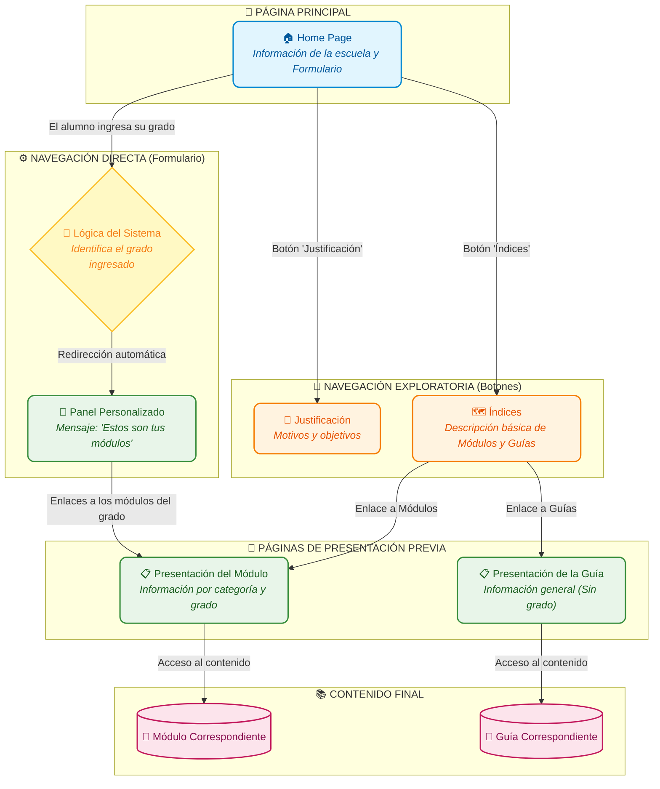

# Arquitectura de Navegación - L.B. Antonio Lemus Pérez

Este documento define la estructura jerárquica de navegación de la aplicación para asegurar una experiencia de usuario coherente y pedagógica, integrando la lógica de personalización por grado académico.

## 1. Diagrama de Flujo (Arquitectura Completa)

## 2. Descripción del Flujo de Navegación

El flujo de navegación de la plataforma está diseñado para ofrecer dos vías de acceso a los contenidos: una exploratoria (mediante menús e índices) y una directa (mediante un formulario inteligente). A continuación, se detalla el recorrido del usuario:

### 1. Inicio (Home Page)
Al abrir la plataforma, el usuario aterriza en la página principal (*Home Page*). Esta pantalla cumple tres funciones principales:
- Muestra la información institucional y básica de la escuela.
- Presenta los botones de navegación general hacia las secciones "Justificación" e "Índices".
- Muestra un formulario de ingreso rápido para los estudiantes.

### 2. Ruta Exploratoria (Mediante Botones)
Si el usuario decide explorar la plataforma de forma manual, utiliza los botones ubicados en el Home:
- **Justificación:** Al hacer clic, se abre una página estática que explica los objetivos y fundamentos del sistema.
- **Índices:** Al hacer clic, se abre un catálogo que contiene descripciones breves sobre qué son y qué hacen los módulos y las guías. Desde esta pantalla, se abren dos sub-rutas:
    - *Ruta hacia Módulos:* Enlaces que dirigen a una "Presentación Previa del Módulo" (categorizada por grado y tema).
    - *Ruta hacia Guías:* Enlaces que dirigen a una "Presentación Previa de la Guía" (estas son de carácter general y no están atadas a un grado específico).

### 3. Ruta Directa / Personalizada (Mediante Formulario)
Para facilitar el acceso a los estudiantes, el Home cuenta con un sistema directo:
- **Ingreso de Datos:** El estudiante introduce su grado en el formulario.
- **Lógica del Sistema:** La plataforma captura el dato y compara a qué grado pertenece.
- **Panel Personalizado:** El sistema redirige automáticamente al estudiante a una pestaña de presentación unificada. Esta pantalla incluye un mensaje personalizado (Ej. *"Estos son tus módulos de 1er grado"*) y lista exclusivamente las presentaciones previas de los módulos correspondientes a ese año.

### 4. Destinos Finales (Acceso al contenido)
Independientemente de la ruta tomada (Exploratoria o Directa), el paso previo al contenido siempre es una página de "Presentación":
- **Desde la Presentación del Módulo:** El usuario encuentra toda la información de la categoría y grado. Al presionar el enlace de acceso, llega al **Módulo Final** correspondiente.
- **Desde la Presentación de la Guía:** El usuario lee de qué trata la guía de apoyo y, mediante un enlace, accede a la **Guía Final** correspondiente.
